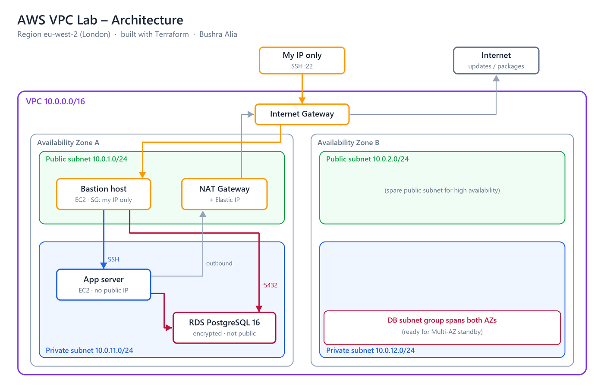

# AWS VPC Lab – Secure Multi-Tier Network with Terraform


A secure, multi-tier AWS network: public and private subnets across two Availability Zones, a NAT gateway, a bastion host, tightly scoped security groups, and an **encrypted RDS PostgreSQL** database that is never exposed to the internet.

**How I built it:** I built this lab by hand in the **AWS Console** to understand every component – the VPC, subnets, route tables, NAT gateway, bastion host, security groups and network ACLs – then ran RDS PostgreSQL privately and moved it to encrypted storage (snapshot → encrypted copy → restore), checking that every row was still there.

**The Terraform in this repo** describes the same design as Infrastructure as Code, so the environment can be recreated, reviewed and destroyed with one command. It passes `terraform fmt` and `terraform validate` in CI. Running a full `terraform apply` of this version is my next step (see below).



## What it builds

| Layer | Resources | Why |
|---|---|---|
| Network | VPC `10.0.0.0/16`, 2 public + 2 private subnets in 2 AZs | Separates internet-facing and internal resources |
| Internet access | Internet Gateway, NAT Gateway + Elastic IP, route tables | Public subnets reach the internet directly; private subnets get **outbound-only** access through NAT |
| Access | Bastion host (EC2) in a public subnet | The **only** entry point. SSH is allowed from my IP address only |
| App tier | EC2 instance in a private subnet | No public IP. Reached only through the bastion |
| Data tier | RDS PostgreSQL 16 in a DB subnet group across both AZs | `publicly_accessible = false`, encrypted at rest, plus an encrypted manual snapshot |
| Subnet firewall | Network ACLs for the public and private subnets | A second, **stateless** layer: only the ports each subnet needs, everything else denied |
| Security | Security groups that reference each other | DB accepts port 5432 **only** from the bastion and app security groups |

## Security decisions

- **Least privilege networking:** each security group allows only the traffic that tier needs, using security-group references instead of wide CIDR ranges.
- **Defence in depth with NACLs:** every subnet has its own network ACL. The public NACL allows SSH only from my IP plus web and return traffic; the private NACL allows SSH only from the public subnets and PostgreSQL only from inside the VPC. Because NACLs are stateless, return traffic on ephemeral ports (1024–65535) is allowed explicitly.
- **No public database:** RDS lives in private subnets with `publicly_accessible = false`.
- **Encryption everywhere:** RDS storage, the RDS snapshot and the EC2 root volumes are all encrypted.
- **No passwords in code:** `manage_master_user_password = true` makes RDS generate the password and store it in **AWS Secrets Manager**.
- **IMDSv2 only** on EC2, to protect instance credentials.
- **SSH locked to one IP:** a Terraform validation rule refuses `0.0.0.0/0`.
- **CI pipeline:** GitHub Actions runs `terraform fmt` and `terraform validate` on every push.

## How to run it

**Requirements:** Terraform 1.15+, AWS CLI configured (`aws configure`), and an SSH key.

```bash
# 1. Create an SSH key (skip if you already have one)
ssh-keygen -t ed25519

# 2. Add your IP address
cp terraform.tfvars.example terraform.tfvars
#    then edit terraform.tfvars, e.g. my_ip_cidr = "81.2.3.4/32"

# 3. Build it (RDS takes about 10 minutes)
terraform init
terraform plan
terraform apply

# 4. Test it
terraform output ssh_to_bastion           # connect to the bastion
terraform output ssh_to_app_via_bastion   # jump to the private app server
```

**Connect to the database from the bastion:**

```bash
# On your own computer: get the generated password from Secrets Manager
aws secretsmanager get-secret-value --secret-id "$(terraform output -raw db_password_secret_arn)" --query SecretString --output text

# On the bastion
psql -h <db_endpoint> -U labadmin -d labdb
```

**Prove the private server uses the NAT gateway:** on the app server, run `curl https://checkip.amazonaws.com`. It returns the NAT gateway's Elastic IP (`terraform output nat_gateway_public_ip`), not its own address.

## ⚠️ Cost: destroy when finished

The NAT gateway, Elastic IP and RDS instance cost money every hour they run. When you have finished testing:

```bash
terraform destroy
```

## What I learned

- How route tables decide whether a subnet is public or private
- Why private instances need a NAT gateway to download updates, and why it must sit in a public subnet
- Using a bastion host and SSH jump (`-J`) to reach instances that have no public IP
- Chaining security groups so each tier only trusts the tier in front of it
- The difference between security groups (instance level, stateful, allow only) and NACLs (subnet level, stateless, allow and deny, numbered rules)
- Why a stateless NACL must allow ephemeral return ports, or connections silently fail
- Why RDS needs a DB subnet group across at least two AZs
- That snapshots of an encrypted database are automatically encrypted
- How the same console design is described as Terraform resources (VPC, subnets, route tables, security groups, RDS)

## Next steps

- Run `terraform apply` on this code, repeat the console tests (SSH via the bastion, NAT check, `psql` to RDS) and add screenshots
- Replace the bastion with **AWS Systems Manager Session Manager** (no open SSH port)
- Add **VPC Flow Logs** to CloudWatch
- Enable **Multi-AZ** RDS and one NAT gateway per AZ for high availability
- Move state to an **S3 backend with DynamoDB locking** (see the commented block in `versions.tf`)

---
Built by **Bushra Alia** · AWS Certified Solutions Architect – Associate
